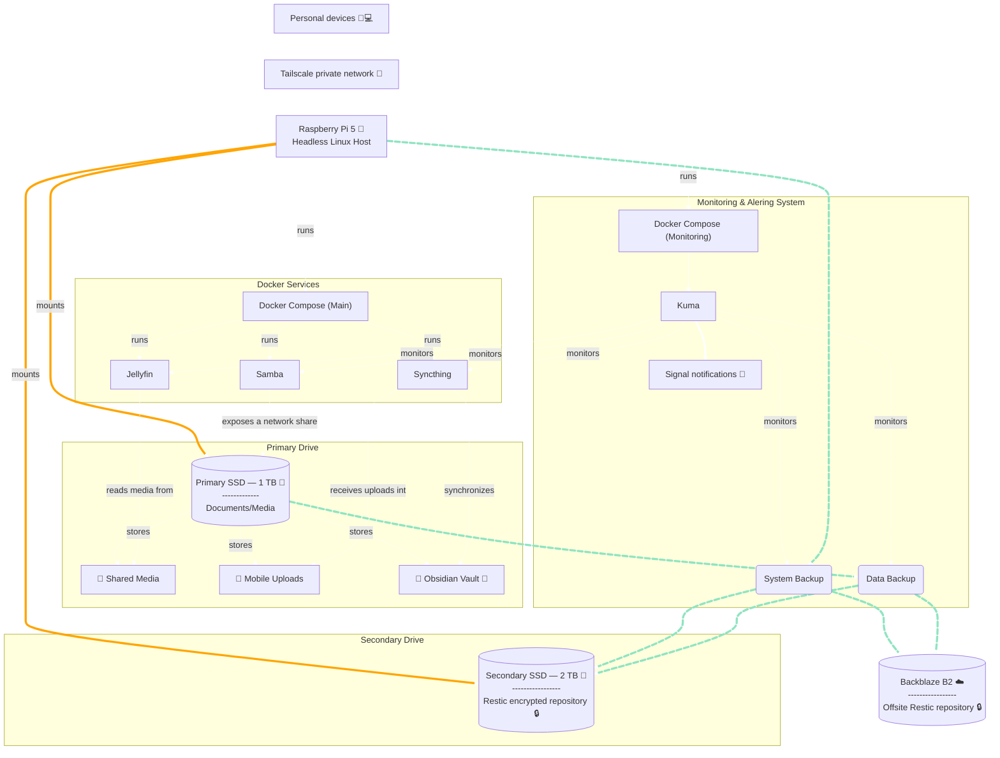

# Self-Hosted Home Lab

A Raspberry Pi 5 home server built around **private networking, containerized services, automated encrypted backups, and operational monitoring**.

This project documents a self-hosted environment used for file sharing, media streaming, device synchronization, data organization, and backup automation. 

## Overview

The system runs on a headless Raspberry Pi 5 with two attached SSDs. Docker Compose manages the primary application services, Tailscale provides private connectivity between trusted devices, and Restic performs scheduled encrypted backups.

Uptime Kuma monitors application services and scheduled automation. Failed checks generate notifications through Signal.  
 
Beszel monitors system and container health via the web UI and configurable notifications.

### Key capabilities

- **Containerized services:** Samba for file sharing, Jellyfin for media streaming, and Syncthing for device synchronization.
- **Private networking:** Tailscale connects the server and personal devices without relying on direct public exposure of the services.
- **Host security:** UFW firewall rules, SSH public-key authentication, and restricted remote administration.
- **Encrypted backups:** Restic backs up the Raspberry Pi system and primary data drive to a repository on a separate local SSD and to an offsite repository on Backblaze B2.
- **Automated workflows:** Scheduled Obsidian Git commits and mobile photo organization.reree
- **Monitoring and alerting:**
  - Uptime Kuma checks service availability and receives push heartbeats from scheduled jobs; Signal delivers notifications when monitored checks fail.
  - Beszel monitors the health of the host (Pi) as well as the individual service containers.

## Documentation

| Document | Covers |
|---|---|
| [Architecture](docs/architecture.md) | Hardware, storage layout, services, and data flows |
| [Networking and security](docs/networking-and-security.md) | Tailscale, UFW, SSH, service exposure, and how to verify it |
| [Backups and recovery](docs/backups-and-recovery.md) | Restic jobs, retention, repository checks, restore procedures, and a recovery checklist |
| [Operations and monitoring](docs/operations-and-monitoring.md) | Monitored checks, alerting, scheduled tasks, logs, and outage diagnosis |
| [Provisioning](provisioning/README.md) | Setting up or rebuilding the Pi: the provisioning script, then firewall, drives, secrets, containers, and crontabs |


## Architecture




The diagram shows logical relationships rather than exact network routes or mount configuration. The secondary SSD stores the local Restic repository. Each backup job also writes to a separate offsite Restic repository on Backblaze B2.

For a fuller diagram showing how Beszel monitors system/container health at a high-level see [the Beszel diagram](https://github.com/QuantumZenoSix/home-lab/blob/main/diagrams/architecture_with_beszel.md).

## Services

| Component | Purpose |
|---|---|
| [Beszel](https://www.beszel.dev/) | System/container health monitoring | 
| [Uptime Kuma](https://uptime.kuma.pet/) | Service monitoring and scheduled-job heartbeat monitoring | 
| [Signal integration](https://github.com/bbernhard/signal-cli-rest-api) | Failure notifications from Uptime Kuma |
| [Tailscale](https://tailscale.com/) | Private connectivity between trusted devices |
| [Syncthing](https://syncthing.net/) | Synchronization of the Obsidian vault and mobile photo uploads |
| [Jellyfin](https://jellyfin.org/) | Media streaming from the primary SSD |
| [Restic](https://restic.net/) | Encrypted system and data backups |
| [Phockup](https://github.com/ivandokov/phockup) | Image Sorting and Organization |
| Samba | Network file sharing |


## Storage and data management

The server uses two USB-attached SSDs:

- **Primary SSD (1 TB):** documents, media, my Obsidian vault, and photo storage.
- **Secondary SSD (2 TB):** the local Restic backup repository (an offsite copy goes to Backblaze B2).

Filesystem mount configuration is documented under `filesystem/etc/fstab`.

Syncthing is configured around the Raspberry Pi as the central (always-on) synchronization point for the Obsidian vault and mobile photo uploads. This design avoids direct laptop-to-laptop or phone-to-laptop synchronization and potential conflicts (when one device is offline) - see [here for more](https://github.com/QuantumZenoSix/home-lab/issues/10).  

The sync setup for the Obsidian vault is bidirectional allowing changes to be pushed to and pulled from the Raspberry Pi. By contrast, the mobile photo sync is a unidirectional sync; where the mobile device (phone) routinely uploads images to the Raspberry Pi while it awaits an organization process.

Mobile photo organization is automated with a script that uses Phockup to organize uploaded images into a date-based timeline folder/subfolder structure. The workflow copies organized images rather than deleting the original uploads.  

A local Git repository tracks Obsidian vault changes on the Raspberry Pi. This provides daily change history alongside the separate Restic backup process (and simple file versioning set up in Syncthing).

## Backup strategy

Two scheduled Restic jobs run daily:

| Schedule | Backup |
|---|---|
| 03:30 | Raspberry Pi system backup |
| 05:00 | Primary-drive data backup |

Each job backs up to two Restic repositories in turn: the local repository on the secondary SSD, then an offsite repository in a Backblaze B2 bucket (through B2's S3-compatible API). Each repository is encrypted with its own password, and the passwords are stored separately from this public documentation. The scripts load each repository's settings from environment files in `/etc/` (`restic-env` and `restic-env-b2`).
These jobs are scheduled using the cron service but can equally be set up with unit/timer files for a systemd service.

Uptime Kuma receives a push heartbeat when a backup command completes successfully. The local and B2 runs report to separate monitors, so the monitoring system can alert when either destination misses an expected heartbeat.

For each repository, the system backup job first runs `restic check` (structure and metadata) and skips that repository if the check fails. After the backup and prune, it runs a restore test: it rewrites a small test file before each run, restores it from that night's system snapshot, compares its checksum with the original, and sends a separate heartbeat when they match. See [Repository checks](docs/backups-and-recovery.md#repository-checks) and [Automated restore test](docs/backups-and-recovery.md#automated-restore-test).

The second SSD separates the backup destination from the primary data drive, and the B2 copy covers loss of the entire server or both drives. Offsite backup was tracked in [this issue](https://github.com/QuantumZenoSix/home-lab/issues/1).

Each repository has its own retention. Locally, the data job keeps 7 daily snapshots and the system job keeps 7 daily plus 6 weekly. The system job keeps more in B2: 30 daily and 12 monthly. So recent restores come quickly from the SSD, and B2 holds older recovery points. That is one reason the setup uses two independent Restic repositories instead of copying the local repository to B2 with rclone. A sync would carry corruption or deletions into the cloud copy, and restoring from a copied repository usually means downloading and rebuilding it first. See [Why two repositories instead of an rclone copy](docs/backups-and-recovery.md#why-two-repositories-instead-of-an-rclone-copy).

_User cron table (ada)_
```shell
0  5 * * * /home/ada/scripts/auto_commit_obsidian.sh >> ~/scripts/auto_commit_obsidian.log
0 */4 * * * /home/ada/scripts/organize_mobile_photos.sh
```

_Root cron table_
```shell
30 3 * * * /root/.restic/restic_backup_system.sh
0  5 * * * /root/.restic/restic_backup_data.sh
```  

## Automation

The project includes scheduled scripts for:

- Committing Obsidian vault changes to local Git history.
- Organizing mobile photo uploads into a date-based directory structure.
- Backing up the Raspberry Pi system with Restic (local SSD and Backblaze B2).
- Backing up primary-drive data with Restic (local SSD and Backblaze B2).
- Reporting successful automation runs to Uptime Kuma.

The user crontab schedules the Obsidian Git commit daily at 05:00 and the photo organization task every four hours. The two Restic jobs run from root's crontab at 03:30 and 05:00, respectively.

## Monitoring and notifications

Uptime Kuma monitors the availability of the Samba, Jellyfin, and Syncthing services, as well as heartbeats from the two backup jobs (for each destination), the system backup's repository check and restore test (for each destination), and the photo organization workflow.

Signal notifications are configured for monitored failures.

The heartbeat checks indicate that a script reached its success-reporting point. They should not be interpreted as proof that all expected data was processed, that synchronization completed without conflicts, or that a backup is fully restorable.

Because Uptime Kuma runs on the same Raspberry Pi, a complete host outage can also take down the monitoring system. Independent monitoring from another device or service to monitor the Pi itself is also planned (maybe a second Pi and they monitor each other? Not sure, we shall see). Tracking this [here](https://github.com/QuantumZenoSix/home-lab/issues/5).

Beyond availability, Beszel also help with monitoring as it monitors the health of the headless Raspberry Pi itself as well as all of the containers running on it tracking metrics like CPU/GPU usage, Disk/Memory/Network activity and more so I can review historical data via the dashboard.

For further diagnoses I use tools like [btop++](https://github.com/aristocratos/btop), [dysk](https://github.com/Canop/dysk), [darya](https://github.com/mrkatebzadeh/darya), [lazydocker](https://github.com/jesseduffield/lazydocker), [dcv](https://github.com/tokuhirom/dcv), and general cli utilities to investigate.

## Repository layout

```text
filesystem/
├── etc/
│   ├── fstab
│   ├── kuma-env
│   ├── kuma-env-b2
│   ├── restic-env
│   ├── restic-env-b2
│   ├── restic-password
│   └── restic-password-b2
├── home/
│   └── ada/
│       ├── containers/
│       │   ├── beszel/
│       │   │   └── docker-compose.yml
│       │   ├── homelab/
│       │   │   └── docker-compose.yml
│       │   └── uptime-kuma/
│       │       └── docker-compose.yml
│       └── scripts/
│           ├── .env_auto_commit_obsidian
│           ├── .env_organize_mobile_photos
│           ├── auto_commit_obsidian.log
│           ├── auto_commit_obsidian.sh
│           └── organize_mobile_photos.sh
└── root/
    └── .restic/
        ├── restic_backup_data.sh
        └── restic_backup_system.sh
```

The `filesystem/` directory mirrors selected paths from the Raspberry Pi to make each configuration file's intended location clear. It is a curated reference, not really a complete system image or a drop-in deployment package.

## Security considerations

- Remote administration and service access are intended to use the private Tailscale network.
- SSH uses public-key authentication and disables root login.
- UFW provides host firewall rules.
- Restic encrypts backup data, and its password is not intended to be published.
- Real credentials, push tokens, API secrets, and private configuration values are kept out of version control (obviously).
- Configuration examples use placeholders and must be reviewed before being applied to another system.

Network exposure and Docker's interaction with host firewall rules should be reviewed against the actual deployed configuration.

## Limitations and future improvements

Planned or potential improvements include:

- Automated repository checks that read pack data (`restic check --read-data-subset`) and report to their own monitor, and restore tests that cover the data snapshots and more than a single test file.
- Independent monitoring for full-host outages.
- Additional investigation documentation into occasional service interruptions and host unresponsiveness.
- More comprehensive deployment and recovery documentation.

These items are distinguished from the features currently implemented so that the documentation reflects the actual state of the system.

For more on known issues and things to improve see the [issues section](https://github.com/QuantumZenoSix/home-lab/issues).  

## Purpose: Learning and engineering focus

This really is my home lab setup but I'm sharing it here to demonstrate practical work with Linux storage and permissions, Docker Compose, private networking, Bash automation, backup operations, monitoring, and notification integrations.

The emphasis is on integrating these components into a useful system and documenting the operational decisions and trade-offs involved.
I plan on adding more info as I troubleshoot generally and as I add more features/updates.

