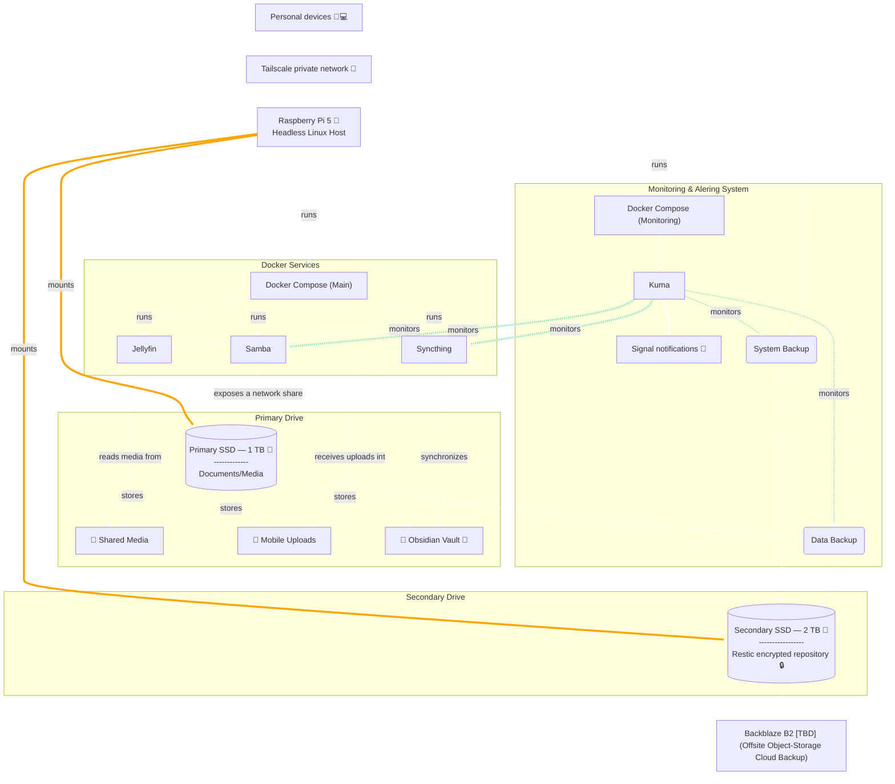

# Self-Hosted Home Lab

A Raspberry Pi 5 home server built around **private networking, containerized services, automated encrypted backups, and operational monitoring**.

This project documents a self-hosted environment used for file sharing, media streaming, device synchronization, data organization, and backup automation. It emphasizes practical Linux administration, security, reliability, and maintainable infrastructure.

## Overview

The system runs on a headless Raspberry Pi 5 with two attached SSDs. Docker Compose manages the primary application services, Tailscale provides private connectivity between trusted devices, and Restic performs scheduled encrypted backups.

Uptime Kuma monitors application services and scheduled automation. Failed checks generate notifications through Signal.  


### Key capabilities

- **Containerized services:** Samba for file sharing, Jellyfin for media streaming, and Syncthing for device synchronization.
- **Private networking:** Tailscale connects the server and personal devices without relying on direct public exposure of the services.
- **Host security:** UFW firewall rules, SSH public-key authentication, and restricted remote administration.
- **Encrypted backups:** Restic backs up the Raspberry Pi system and primary data drive to a repository on a separate local SSD with plans for offsite backup via Backblaze.
- **Automated workflows:** Scheduled Obsidian Git commits and mobile photo organization.
- **Monitoring and alerting:** Uptime Kuma checks service availability and receives push heartbeats from scheduled jobs; Signal delivers notifications when monitored checks fail.

## Architecture




The diagram shows logical relationships rather than exact network routes or mount configuration. The secondary SSD stores the local Restic repository. Offsite backup to Backblaze B2 is a planned extension, not an implemented feature.

## Services

| Component | Purpose |
|---|---|
| Samba | Network file sharing |
| [Jellyfin](https://jellyfin.org/) | Media streaming from the primary SSD |
| [Syncthing](https://syncthing.net/) | Synchronization of the Obsidian vault and mobile photo uploads |
| [Uptime Kuma](https://uptime.kuma.pet/) | Service monitoring and scheduled-job heartbeat monitoring |
| [Restic](https://restic.net/) | Encrypted system and data backups |
| [Tailscale](https://tailscale.com/) | Private connectivity between trusted devices |
| [Signal integration](https://github.com/bbernhard/signal-cli-rest-api) | Failure notifications from Uptime Kuma |
| [Phockup](https://github.com/ivandokov/phockup) | Image Sorting and Organization |


## Storage and data management

The server uses two USB-attached SSDs:

- **Primary SSD (1 TB):** documents, media, my Obsidian vault, and photo storage.
- **Secondary SSD (2 TB):** the local Restic backup repository.

Filesystem mount configuration is documented under `filesystem/etc/fstab`.

Syncthing is configured around the Raspberry Pi as the central (always-on) synchronization point for the Obsidian vault and mobile photo uploads. This design avoids direct laptop-to-laptop or phone-to-laptop synchronization and potential conflicts (when one device is offline). The sync setup for the Obsidian vault is bidirectional allowing changes to be pushed to and pulled from the Raspberry Pi. By contrast, the mobile photo sync is a unidirectional sync; where the mobile device (phone) routinely uploads images to the Raspberry Pi while it awaits an organization process.

Mobile photo organization is automated with a script that uses Phockup to organize uploaded images into a date-based timeline. The workflow copies organized images rather than deleting the original uploads.

A local Git repository tracks Obsidian vault changes on the Raspberry Pi. This provides daily change history alongside the separate Restic backup process (and simple file versioning set up in Syncthing).

## Backup strategy

Two scheduled Restic jobs run daily:

| Schedule | Backup |
|---|---|
| 04:30 | Raspberry Pi system backup |
| 06:00 | Primary-drive data backup |

Both jobs use the local Restic repository on the secondary SSD. The repository is encrypted, and its password is stored separately from this public documentation.
These jobs are scheduled using the cron service but can equally be set up with unit/timer files for a system d service.

Uptime Kuma receives a push heartbeat when a backup command completes successfully. This allows the monitoring system to alert when an expected heartbeat is missed.

**Current limitation:** The second SSD helps separate the backup destination from the primary data drive, but it does not protect against loss of the entire server or both drives. Offsite backup is planned via Backblaze B2.

## Automation

The project includes scheduled scripts for:

- Committing Obsidian vault changes to local Git history.
- Organizing mobile photo uploads into a date-based directory structure.
- Backing up the Raspberry Pi system with Restic.
- Backing up primary-drive data with Restic.
- Reporting successful automation runs to Uptime Kuma.

The user crontab schedules the Obsidian Git commit daily at 05:00 and the photo organization task every four hours. The two Restic jobs run from root's crontab at 04:30 and 06:00, respectively.

## Monitoring and notifications

Uptime Kuma monitors the availability of the Samba, Jellyfin, and Syncthing services, as well as heartbeats from the two backup jobs and the photo organization workflow.

Signal notifications are configured for monitored failures.

The heartbeat checks indicate that a script reached its success-reporting point. They should not be interpreted as proof that all expected data was processed, that synchronization completed without conflicts, or that a backup is fully restorable.

Because Uptime Kuma runs on the same Raspberry Pi, a complete host outage can also take down the monitoring system. Independent monitoring from another device or service to monitor the Pi itself is also planned (maybe a second Pi and they monitor each other? Not sure, we shall see).

## Repository layout

```text
filesystem/
├── etc/
│   └── fstab
├── home/
│   └── ada/
│       ├── homelab/
│       │   └── docker-compose.yml
│       ├── scripts/
│       │   ├── auto_commit_obsidian.log
│       │   ├── auto_commit_obsidian.sh
│       │   └── organize_mobile_photos.sh
│       └── uptime-kuma/
│           └── docker-compose.yml
└── root/
    └── .restic/
        ├── restic_backup_data.sh
        ├── restic_backup_system.sh
        ├── restic_exclude.txt
        ├── restic.log
        ├── restic_pass
        ├── restic_repo_name
        └── example configuration files
```

The `filesystem/` directory mirrors selected paths from the Raspberry Pi to make each configuration file's intended location clear. It is a curated reference, not really a complete system image or a drop-in deployment package.

## Security considerations

- Remote administration and service access are intended to use the private Tailscale network.
- SSH uses public-key authentication and disables root login.
- UFW provides host firewall rules.
- Restic encrypts backup data, and its password is not intended to be published.
- Real credentials, push tokens, API secrets, and private configuration values are kept out of version control (obviously).
- Configuration examples use placeholders and must be reviewed before being applied to another system.

Network exposure and Docker's interaction with host firewall rules should be reviewed against the actual deployed configuration.

## Limitations and future improvements

Planned or potential improvements include:

- Offsite backup of the encrypted Restic repository to Backblaze B2.
- Regular automated repository checks and documented restore tests.
- Independent monitoring for full-host outages.
- Additional investigation documentation into occasional service interruptions and host unresponsiveness.
- More comprehensive deployment and recovery documentation.

These items are distinguished from the features currently implemented so that the documentation reflects the actual state of the system.

## Purpose: Learning and engineering focus

This project is designed to demonstrate practical work with Linux storage and permissions, Docker Compose, private networking, Bash automation, backup operations, monitoring, and notification integrations.

The emphasis is on integrating these components into a useful system and documenting the operational decisions and trade-offs involved.
I plan on adding more info as I troubleshoot generally and as I ad more features/updates.

