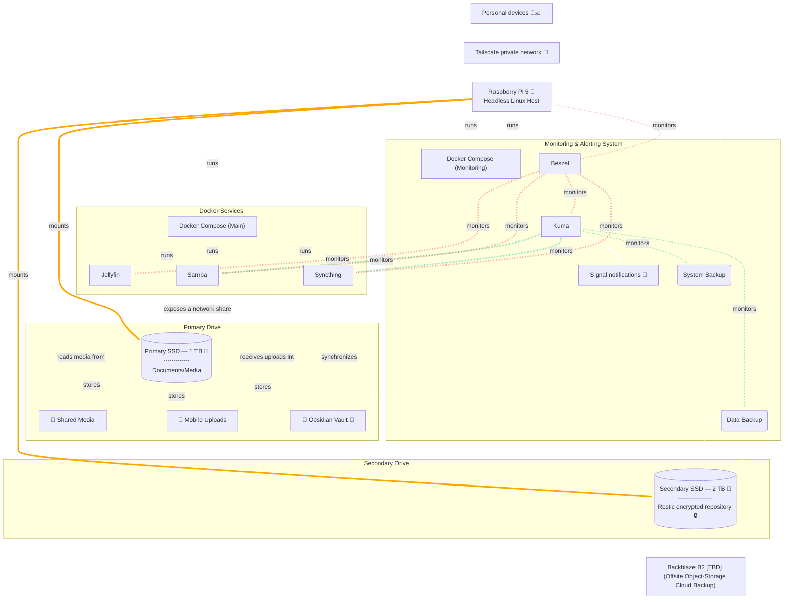

# Architecture

This document describes the hardware, storage layout, services, and data flows of the home lab.  

## Host

| Item | Value |
|---|---|
| Hardware | Raspberry Pi 5, headless |
| Hostname | `ada-pi-server` |
| Primary user | `ada` (uid/gid 1000) |
| Remote access | Tailscale (see [networking-and-security.md](networking-and-security.md)) |
| Scheduling | cron (user `ada` and `root` crontabs) |

## Storage

Both SSDs are USB-attached and mounted by UUID from [`/etc/fstab`](../filesystem/etc/fstab).

| Drive | Mount point | Filesystem | Role |
|---|---|---|---|
| Primary SSD, 1 TB | `/media/HDD-Seagate-1TB-Primary` | exFAT | Documents, media, Obsidian vault, photos |
| Secondary SSD, 2 TB | `/media/HDD-Seagate-2TB-Backup` | ext4 | Local Restic repository (`restic-repo/`) |

Notes on the mount options:

- **`nofail` on both drives.** The Pi still boots if a drive is missing, but services and scripts that expect the mount will find an empty mount point instead. The backup scripts guard against this by checking that `restic-repo/` exists before running.
- **The primary drive is exFAT.** exFAT has no POSIX ownership or permissions, so fstab assigns every file to uid/gid 1000 with `umask=000`. This is why the Syncthing container runs as root (`user: "0:0"`). I may switch to ext4, I really only did exFAT for easy switching between windows/linux but I don't even remove it. I think I just didn't want to deak with NTFS but now I hear it's less troublesome so I may have to move away from exFAT in either case (probably ext4).
- **The backup drive mount has `x-systemd.device-timeout=10`.** If the drive is absent, boot waits only 10 seconds for it instead of the default 90.

Important paths on the primary drive:

| Path | Purpose | Written by |
|---|---|---|
| `Documents/Obsidian/` | Obsidian vault, also a local Git repository | Syncthing, `auto_commit_obsidian.sh` |
| `Pictures/Photo Timelime/` | Photos organized by date | `organize_mobile_photos.sh` (Phockup) |
| `Pictures/MobileUploads/` | Photo upload landing area from the phone | Syncthing |

## Services

Each Docker Compose project lives in its own directory under `/home/ada`.

| Service | Compose project | Networking | Responsibility |
|---|---|---|---|
| Jellyfin | [`homelab/`](../filesystem/home/ada/homelab/docker-compose.yml) | host | Streams media from the primary drive, mounted **read-only** at `/media` |
| Syncthing | [`homelab/`](../filesystem/home/ada/homelab/docker-compose.yml) | host | Syncs the Obsidian vault (two-way) and mobile uploads (phone → Pi) |
| Samba | [`homelab/`](../filesystem/home/ada/homelab/docker-compose.yml) | host | SMB shares for **both** drives (`myhdd`, `myhdd-backup`) |
| Uptime Kuma | [`uptime-kuma/`](../filesystem/home/ada/uptime-kuma/docker-compose.yml) | bridge, publishes `3001` | Service checks, push heartbeats, Signal alerts |
| Beszel hub | [`beszel/`](../filesystem/home/ada/beszel/docker-compose.yml) | bridge, publishes `8090` | Dashboard and history for host and container metrics |
| Beszel agent | [`beszel/`](../filesystem/home/ada/beszel/docker-compose.yml) | host | Collects host and container metrics, reports to the hub over a shared Unix socket |

The three application services use `network_mode: host`. Jellyfin needs it for hardware decoding and Syncthing needs it for local discovery. In host mode (as I understand it) a container binds directly to the Pi's interfaces, so its ports have no Docker port mapping.

Uptime Kuma and the Beszel agent both mount `/var/run/docker.sock`, which lets them inspect container state.

## Scheduled jobs

| Time | Crontab | Script | Reports to Uptime Kuma |
|---|---|---|---|
| Every 4 hours | `ada` | [`organize_mobile_photos.sh`](../filesystem/home/ada/scripts/organize_mobile_photos.sh) | Yes |
| 05:00 daily | `ada` | [`auto_commit_obsidian.sh`](../filesystem/home/ada/scripts/auto_commit_obsidian.sh) | No |
| 04:30 daily | `root` | [`restic_backup_system.sh`](../filesystem/root/.restic/restic_backup_system.sh) | Yes |
| 06:00 daily | `root` | [`restic_backup_data.sh`](../filesystem/root/.restic/restic_backup_data.sh) | Yes |

## Data flows

1. **Obsidian vault.** Laptops and the phone sync with the Pi through Syncthing, so the always-on Pi is the hub and devices never sync with each other directly. At 05:00 a cron job commits any changes in the vault to its local Git repository.
2. **Mobile photos.** The phone uploads one-way into `MobileUploads/`. Every four hours Phockup **copies** the new files into a date-based tree under `Photo Timelime/`. The originals stay in place.
3. **Media.** Jellyfin reads from the primary drive (music, photo timeline, etc) and never writes to it.
4. **File sharing.** Samba serves both drives over SMB. Both shares are writable by `ada`.
5. **Backups.** Restic backs up the system (`/`, excluding `/media` and other volatile paths) at 04:30 and the primary drive at 06:00. Both go to the encrypted repository on the secondary SSD. See [backups-and-recovery.md](backups-and-recovery.md).
6. **Monitoring.** Uptime Kuma checks the three application services and receives push heartbeats from the scheduled jobs: both backups, both prunes, photo organization, and the Obsidian auto-commit. Missed checks trigger a Signal alert. Beszel records resource metrics for the host and its containers. See [operations-and-monitoring.md](operations-and-monitoring.md).

## Diagram

This is the same diagram as [`diagrams/architecture_with_beszel.md`](../diagrams/architecture_with_beszel.md). Orange edges are drive mounts, green edges are backup flows, and faded red edges are Beszel's monitoring. Backblaze B2 is planned and not yet implemented.

The diagram shows logical relationships, not exact network routes. The diagram doesn't draw the photo-organization heartbeat, though Uptime Kuma does monitor it.
